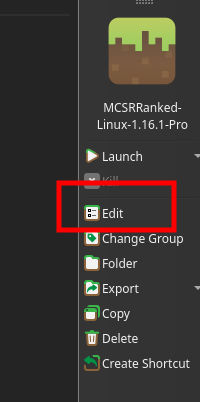
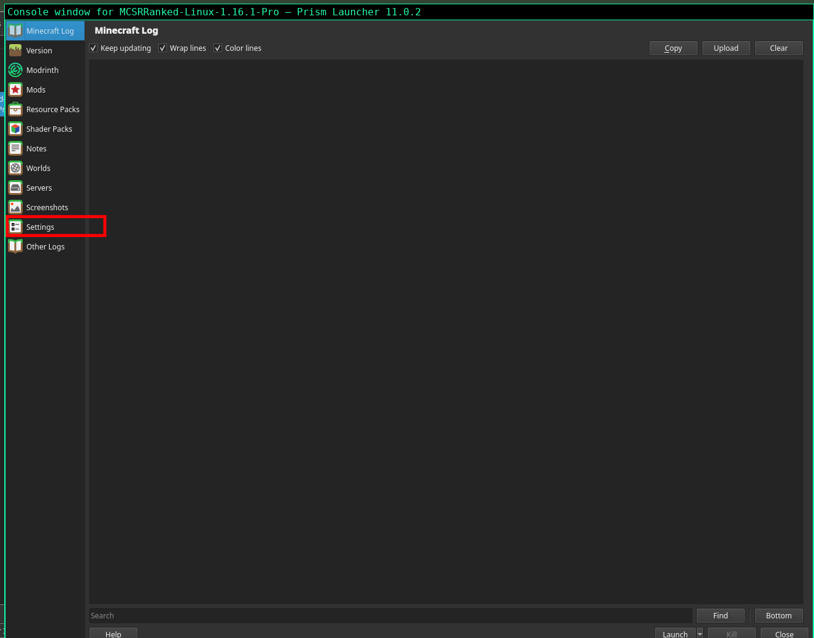
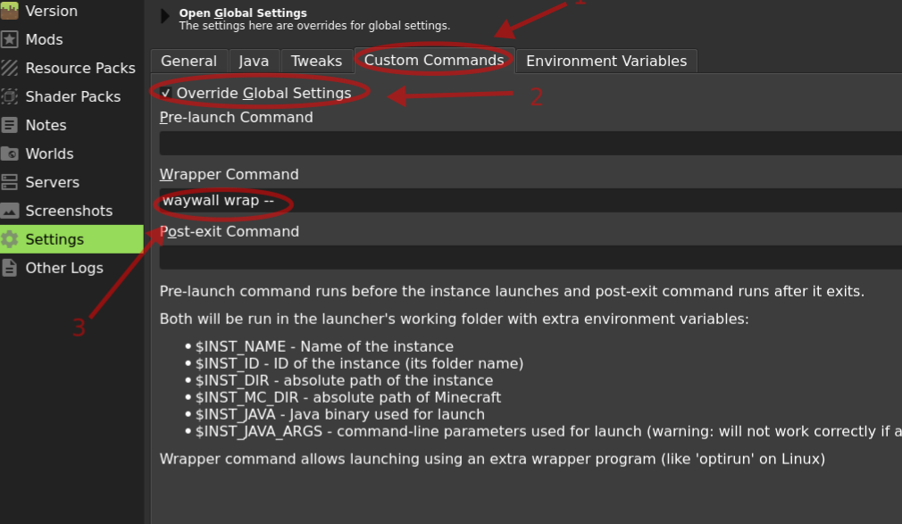
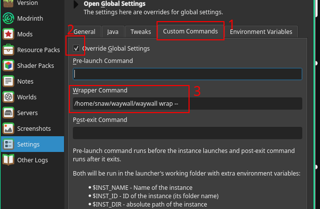
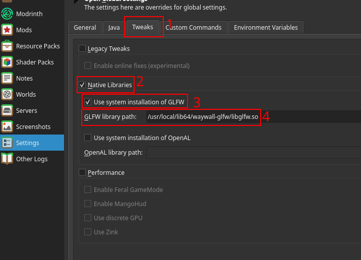
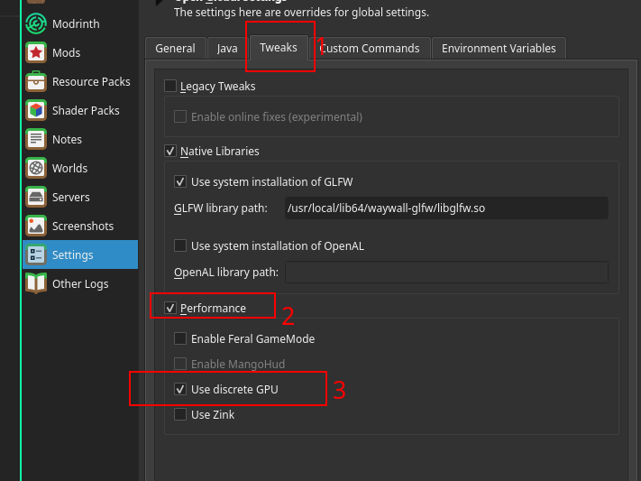

# waywall

- **waywall** is a Wayland compositor designed to run inside your existing Wayland session. It provides various convenient features for speedrunning, including but not limited to:
  - Window resizing
  - Key remapping
  - Ninjabrain Bot support
  - Mirrors (i.e. magnifiers for eye measuring, F3, etc.) without using OBS
  - Lots of custom functionality.
- If you're using **X11**, please use [resetti](../x11/resetti.html) instead.

## Installation
- To install waywall on **Fedora** / **Nobara**:
  - **Fedora 42 / Nobara 42 onwards**, prebuilt binaries are available and is recommended way to install waywall. Please download the `.x86_64.rpm` package from [releases of waywall](https://github.com/tesselslate/waywall/releases). 
    - If you are using KDE Plasma (default with Desktop edition of Fedora), installation can be done by double clicking on .rpm file and installing it via Discover app.
    - In any other case you can use, `sudo dnf install [path_to_rpm_file]` provide path to `.rpm` file. 

      Example: `sudo dnf install ~/Downloads/waywall.x86_64.rpm`
    

  - **Fedora 41 / Nobara 41 and below** 
    - First install the dependencies with the following terminal command:

      ```bash
      sudo dnf install libspng-devel cmake meson mesa-libEGL-devel luajit-devel libwayland-client libwayland-server libwayland-cursor libxkbcommon-devel xorg-x11-server-Xwayland-devel wayland-protocols-devel wayland-scanner wayland-devel libXcursor-devel libXi-devel libXinerama-devel libXrandr-devel
      ```

    - Then, run the commands on [this page of the waywall documentation](https://tesselslate.github.io/waywall/00_installation.html#compiling) to compile waywall from source.
    

- On **Arch Linux / Arch linux derivatives**:
  - Prebuilt binary(waywall + glfw) is available in [waywall releases](https://github.com/tesselslate/waywall/releases) and is recommended way to install waywall.
    1. Download the `waywallXXXXX-x86_64.pkg.tar.zst`. where `XXXXX` is version
    2. Copy the path to `*.pkg.tar.zst` and install it using pacman with following command:
       `sudo pacman -U waywallpkgpath`
        
        Example: `sudo pacman -U ~/Downloads/waywall-0.5-1-x86_64.pkg.tar.zst`
      
      once finished you can proceed with next section and if any of the dependancies are missing please install them by searching on web and then run the above command again.
  - Waywall package is available in AUR however it does not come GLFW(graphics library that Minecraft uses), waywall requires custom GLFW to work, either you build GLFW manually described in this section of [waywall documentation](https://tesselslate.github.io/waywall/00_setup.html#glfw) or download prebuilt GLFW from this [frontcage glfw update](https://frontcage.com/t/how-to-comply-with-recent-glfw-rule-changes/139?u=r0hkx).


- On **Debian** , prebuilt binaries are available for waywall however they only work with **Debian 13 and up** as older versions do not have updated dependencies to run waywall and older versions should use x11 and [resetti](../x11/resetti.html) instead. Please download `.deb` version from [releases of waywall](https://github.com/tesselslate/waywall/releases).  
  - Installation of package can be done by double clicking on `.deb` and installing using default system install.
  - In any other case apt can be used to install .deb packages using following command.
  `sudo apt install locationTodebfile` eg. `sudo apt install ~/Downloads/waywall.deb`
- On **Ubuntu**/**Ubuntu based Distros (Linux Mint, MX Linux, Pop OS! etc)**,  
  
  - **Ubuntu 26.04** has been tested and verified  working with waywall using `.deb` package. Follow the same installations instruction as Debian.
  - **Linux Mint 22.3 and below/Any distro based on Ubuntu 24.04 or below** cannot run waywall due outdated dependencies and should switch to x11 and use [resetti](../x11/resetti.html) instead.

## Verification of installation
- Run `waywall` or **whole path to binary if you have built from source** in a terminal to check it's installed properly.
  it should produce similar output:
  ```waywall

  Usage:
          waywall wrap -- CMD      Run the specified command in a new waywall instance

  Options:
          --profile PROFILE        Run waywall with the given configuration profile
          --allow-mc-x11           Allows Minecraft to run under X11. This will result
                                  in a degraded experience.
          --no-env-reexec          Disable re-executing waywall with the parent process'

  ```
 
## GLFW and Instance setup
Once you have waywall installed either from prebuilt binaries or built from source and verified it is working as described in previous section [Verification of installation](#verification-of-installation) then you can proceed with following section. This sections assumes you are using Prism Launcher if not please check documentation of the launcher you are using.
### Waywall Wrapper command
  - **If you installed waywall from prebuilt binary**, you can use `waywall wrap --` in your wrapper command for you instance using following steps

    1. Click on edit instance of your minecraft instance

        
    2. Go to settings in your edit instance page
        
    3. Click on custom commands tab in settings , tick Override Global settings if its already not ticked then copy paste `waywall wrap --` under Wrapper command section as described in following image
      
  - **If you built waywall from source or are using full path.**
    1. Follow same steps as step 1 and 2 from above.
    2. Click on custom commands tab in settings , tick Override Global settings if its already not ticked then copy paste the **ABSOLUTE Path** to your waywall binary in wrapper command e.g if you have built waywall binary in home/username/waywall/waywall , you need to add that path as such to your wrapper command `/home/username/waywall/waywall wrap --`
    
        

### GLFW path
1. Locate GLFW path and copy it.
    - If you installed waywall using prebuilt binaries(.rpm,.deb,pkg.tar.zst), you should have GLFW library located at following location `/usr/local/lib64/waywall-glfw/libglfw.so`
    - If you have built GLFW from source or using prebuilt GLFW builds from [frontcage GLFW update](https://frontcage.com/t/how-to-comply-with-recent-glfw-rule-changes/139?u=r0hkx). You should copy the complete path to that e.g if you have glfw.so at `/home/username/Downloads/glfw.so`, that's the path you should copy.
2. Click on edit instance of your minecraft instance

    

3. Go to settings in your edit instance page


4. Go to Tweaks tab in settings . Tick `Native Libraries` checkbox if its not already ticked. Tick `Use system installation of GLFW` checkbox option if its not already ticked then **paste the path you copied earlier in GLFW library path input box**



### Next Steps
After doing wrapper command and putting glfw path. Launch minecraft once and verify it launches , once confirmed it launches  move on to the [next section](waywall-config.html) to install an example config and learn how to customize it to your liking.

## Troubleshooting
On dual-GPU setups (i.e. laptops with integrated and dedicated graphics), waywall may not display mirrors correctly, specifically if the desired GPU is an NVIDIA one.

  - With modern waywall , you can do following:
    1. Click on edit instance of your minecraft instance

        

    2. Go to settings in your edit instance page
    

    3. Go to Tweaks tab in settings . Tick Performance checkbox if its not already checked then tick Use Discrete GPU checkbox if its not already ticked



**In case above doesnt work** please do the following:
  - Arch users should check `nvidia-prime` is installed.
  - If you're on another distro (i.e. Fedora):
    - Run the below commands to create the prime-run script on your PATH:

      `mkdir ~/.local/bin`
      `cd ~/.local/bin`
      `touch prime-run`
      `nano prime-run`

    - Then, paste the following text, and save and exit the file with Ctrl+X:

      ```bash
        #!/bin/bash
        __NV_PRIME_RENDER_OFFLOAD=1 __VK_LAYER_NV_optimus=NVIDIA_only __GLX_VENDOR_LIBRARY_NAME=nvidia "$@"
      ```

    - Finally, make the script executable by running `sudo chmod +x prime-run`.

    - Then, modify your wrapper command in your instance's settings in Prism like so:

      ```bash
      sh -c "waywall wrap -- prime-run $INST_JAVA \"$@\""
      ```

    - Remember to replace `waywall` with the absolute path if you must.
    - Finally, uncheck "Use discrete GPU" in Prism Launcher settings if it was checked earlier when [setting up Minecraft](../mmc.html#Further-optimizations).
